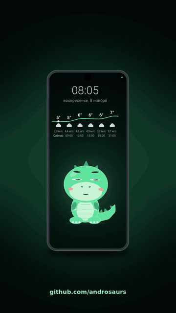
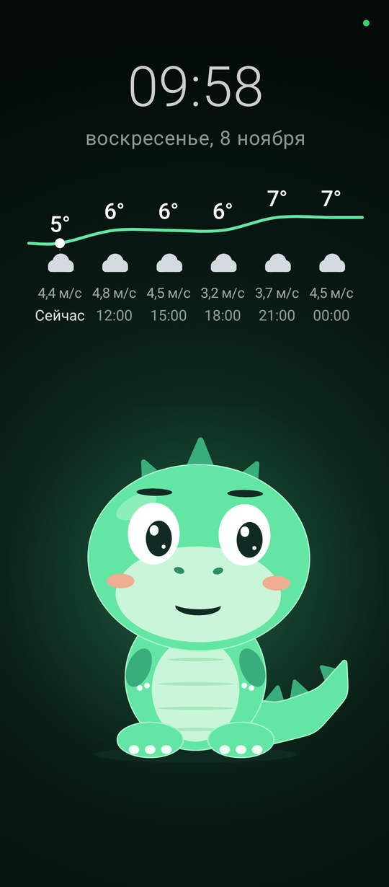
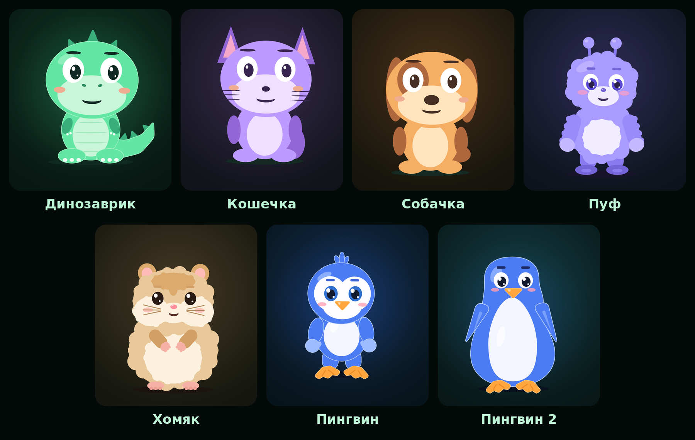

# Androsaur

**English** | [Русский](README.ru.md)

**A home voice assistant built from an old Android phone.** A living character on the screen hears its name, recognizes people by
face, passes on notes, and tells the time and weather. Recognition and commands run on the phone itself, no cloud.

<p align="center"></p>

*The house is quiet, the dinosaur sleeps. We call "Zyuzya" (the default name), the phone recognizes the person and shows their own
character, which delivers a note and puts on glasses by voice command.*

> The voice interface is currently in Russian (wake word, commands, notes). The app code, modules and documentation links below are
> in English where noted; most files under `docs/` are in Russian for now.

## What it is and why

You put an old phone on a stand. It listens for its name ("Zyuzya" by default), looks at who is in front of it, and answers with a
face, a voice and a note. Why bother:

- **A second life for a phone.** All you need is an ordinary Android phone with a screen and a camera; at home it works as a permanent assistant. Tested on a Xiaomi Redmi 12 (Android 15).
- **Privacy.** The phone itself recognizes the name and faces. The hub and cloud services are only needed for optional things: shared settings,
  note transcription, smart home. Without the hub everything else keeps working.
- **A home character.** It knows the family: each person has their own character, it passes on notes and greets people once a day with the weather.

## What it looks like

<table>
<tr>
<td width="260" valign="top"></td>
<td valign="top">

The main screen: clock and date, a weather forecast strip, and a character that breathes, blinks, follows the person with its eyes and talks
(the mouth moves with the sound). The person's name appears under the face while they are in front of the camera. When nobody is around, the character falls asleep and the screen goes dark.

If a person has been sitting for too long, the character gets tired and asks them to take a break. The background softly glows in the selected character's color.

</td>
</tr>
</table>

### Seven characters

<p align="center"></p>

The dinosaur is shown by default until a person is recognized. A recognized person gets their own character. Puf, the hamster and the
penguins can be dressed by voice ("put on glasses", "take everything off"). How characters, outfits and rebuilds work: [docs/characters.md](docs/characters.md) (in Russian).

## What it can do

- **Wakes up by name:** say "Zyuzya", the face comes alive and looks at you.
- **Recognizes people** and greets them at the first meeting of the day: time of day, weather, optionally a horoscope.
- **Notes delivered by face:** "You have a message from …" is played when the right person is in front of the camera.
- **Clock and weather** on the screen; the phone takes the weather from the hub or fetches it itself (MET Norway) and keeps showing the last one when offline.
- **Short voice commands without an LLM:** time, weather, timer, simple arithmetic.
- **Family memory** ("remember the batteries are in the top drawer", "recall", "forget") and **a message to a speaker** in another room
  (needs the hub).
- **Reminds you not to sit too long:** the character gets tired and finally "drops from exhaustion".

The full list with example phrases and details: [docs/features.md](docs/features.md) (in Russian).

## What it consists of

| Repository | What it does |
| --- | --- |
| [androsaur](https://github.com/androsaurs/androsaur) (this one) | main app: the face and the "brain", builds behavior from the modules' events |
| [androsaur-audio](https://github.com/androsaurs/androsaur-audio) | audio: wake word, recording and playing speech, notes |
| [androsaur-camera](https://github.com/androsaurs/androsaur-camera) | camera: faces, people |
| [androsaur-hub](https://github.com/androsaurs/androsaur-hub) | home server: settings, people at home, smart home, memory (optional) |
| [androsaur-stand](https://github.com/androsaurs/androsaur-stand) | motorized stand (CAD, electronics) |

The app itself neither listens nor films: it starts the audio and camera modules on the phone and talks to them over HTTP on localhost.
The protocol and the list of requests: [docs/features.md](docs/features.md#как-это-связано-с-модулями) (in Russian).

## Quick start

```
./gradlew :androidApp:assembleDebug :shared:jvmTest :androidApp:lintDebug
```

You need JDK 17 and the Android SDK (`ANDROID_HOME`). Measured only on a Xiaomi Redmi 12, Android 15.

First install the audio and camera modules on the phone (signed with the same key), then this app. The hub is optional: without it the
app works on the last settings it received; the phone is paired with the hub by a one-time code from the admin panel (panel → "Подключить к хабу"), see [docs/features.md](docs/features.md).

## Documentation

- [docs/features.md](docs/features.md): all features and how it talks to the modules;
- [docs/characters.md](docs/characters.md): characters, outfits, expressions, rebuilding the rigs;
- [docs/demo-recording.md](docs/demo-recording.md): how to record demo clips for announcements (script → screen recording → assembly);
- [CHANGELOG.md](CHANGELOG.md): version history.

Docs are in Russian for now; the README is available in [Russian](README.ru.md) as well.

## What is not done

Autostart and recovery of the modules after a reboot or a killed process, connecting to the hub by scanning a QR code (for now the code is typed in), stand
control (ESP32), an LLM, behavior more complex than "reflexes". Random triggers of the face detector sometimes delay the screen dimming.

## License

Copyright © 2026 hram (Evgeny) and Androsaur project contributors.

The code is released under the [GNU Affero General Public License v3.0 or later](LICENSE) (AGPL-3.0-or-later).
You may use, change and distribute it, but any modified version, including one run as a network service, must be open under the same
license. A commercial license without this condition can be discussed with the author. Third-party libraries and models remain under
their own licenses.
